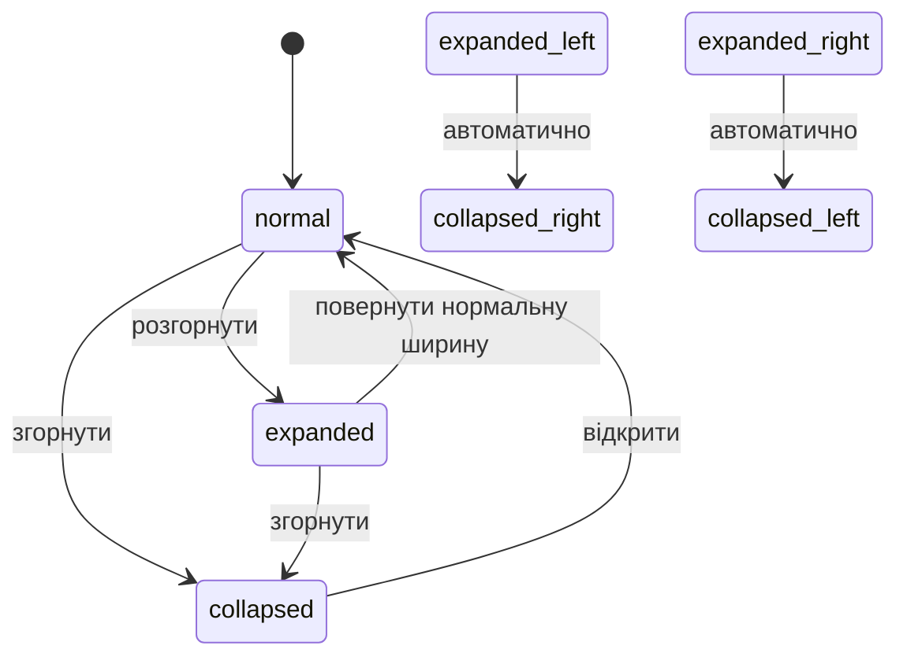

# Концепт інтерфейсу: повноекранна сцена та фіксовані віджети

Статус: погоджені вимоги власника, 14 листопада 2026. Цей документ навмисно лежить у `design/` гілки задачі: загальні `docs/` команда веде в `coordination`.

## Принципи

1. Є **єдиний постійний хедер**: логотип і назва → навігація вкладок → усі кроки дати й календар UTC → UA/EN, Fullscreen, підказки.
2. **Місяць** і **Система** — повноекранні сцени без прокручування сторінки. Картка не обмежується звичайною сіткою колонок. Віджети мають напівпрозорий фон та стоять поверх сцени.
3. **Лівий віджет**: вибір / графіки / сценарій; **правий**: метрики; **нижній док**: інструменти саме цієї сцени.
4. Віджети **не перетягуються**. Позиції фіксовані. Є три стани: `normal` (напівпрозорий поверх сцени), `collapsed` (компактний крайовий перемикач) і `expanded`.
5. При `expanded` одного бокового віджета він займає **50 % робочої ширини**, протилежний **автоматично згортається**, а реальна область 3D-сцени зменшується до решти 50 % (canvas отримує resize, не маскується під панеллю).
6. Згортання не видаляє DOM і не скидає введені поля, карту, координати або розрахунки.
7. **Підбір**, **Місія**, **Вікно запуску** — окремі аналітичні сторінки **без карти**: ліворуч параметри; центр — результати; для «Підбору» додатково справа — ШІ-поради. «План місії» зберігаємо як ще одну аналітичну сторінку.
8. Усі значення метрик беруться з поточних сервісів/API. Візуалізація та переупорядкування DOM не впливають на математичні розрахунки.
9. Не створюємо новий URL API заради дизайну; внутрішні ID полів залишаються стабільними.

## Схема екрана зі сценою

```text
┌────────────────────────────────────────────────────────────────────────────────┐
│ 🌙 Lunar Site Explorer │ Місяць Система Підбір Місія План Вікно │ ← дата → │ UA ⛶ ? │
├────────────────────────────────────────────────────────────────────────────────┤
│ ┌─ Лівий віджет ──────┐                            ┌─ Правий віджет ──────────┐ │
│ │ Вибір / графіки  - □│       ПОВНОЕКРАННА         │ - □  Метрики              │ │
│ │ координати, графіки │         3D-СЦЕНА           │ показники й джерела      │ │
│ │ порівняння / політ  │                            │ висота, Сонце, DSN…      │ │
│ └─────────────────────┘                            └──────────────────────────┘ │
│            ┌── нижній док: вигляд · шари · освітлення · масштаби · ⋯ ──┐       │
└────────────────────────────────────────────────────────────────────────────────┘
```

### Розгорнутий лівий віджет

```text
┌────────────────────────────────────────────────────────────────────────────────┐
│                                   ХЕДЕР                                        │
├───────────────────────────────────────┬────────────────────────────────────────┤
│ ЛІВИЙ ВІДЖЕТ: 50 %                    │ 3D-СЦЕНА: 50 %              │› метрики│
│ вибір місця, графіки, порівняння      │ карта реально змінює       │згорнуті│
│ власний скрол                          │ розмір canvas               │        │
│                                       │ нижній док карти           │        │
└───────────────────────────────────────┴────────────────────────────────────────┘
```

Для розгорнутого правого віджета композиція дзеркальна. Лише один боковий віджет може бути розгорнутим. Коли користувач повертає його у `normal`, інший залишається згорнутим, доки користувач сам його не відкриє.

### Стани



## Схема аналітичних вкладок

```text
┌────────────────────────────────────────────────────────────────────────────────┐
│                                   ХЕДЕР                                        │
├───────────────────┬─────────────────────────────────┬──────────────────────────┤
│ Лівий віджет      │ Центральне поле                 │ Правий віджет            │
│ Форма параметрів  │ Таблиці, графіки, результати    │ Лише «Підбір»: ШІ-поради │
│ Згортання         │ Ширина збільшується при         │ Згортання                │
│                   │ згортанні сусіднього віджета    │                          │
└───────────────────┴─────────────────────────────────┴──────────────────────────┘
```

«Місія», «Вікно запуску» та «План місії» мають лише дві колонки — форма + результати. Ніякого фонового глобуса на цих сторінках немає.

## Розміщення змісту

| Сторінка | Лівий віджет | Сцена / центр | Правий віджет | Нижній док |
|---|---|---|---|---|
| Місяць | каталог/координати, температура, таймлайн, порівняння | куля, 2D, полярний вид, вид з поверхні | місце, рельєф, Сонце, Земля, DSN, температура, радіація | вигляд, шари, сітка, якість, освітлення, рельєф; для виду з поверхні — режими/час |
| Система | вибір об'єкта і параметри польоту | інтерактивна 3D-система | стан системи, телеметрія, спільні метрики точки | масштаб, режим системи, орбіти, симуляція |
| Підбір | вимоги, пріоритети й запуск | рейтинг, таблиця, порівняння | пояснення/поради ШІ | немає |
| Місія | конфігурація | маса, вартість, ризики, складові | немає | немає |
| Вікно запуску | майданчик, траєкторія, пріоритети | шкала дат, найкраще вікно, таблиця | немає | немає |
| План місії | профіль, вимоги, ракета | варіанти плану, результат | немає | немає |

## Розміри та адаптивність

- Хедер: близько 64–72 px, фіксований. На вузьких екранах адаптується, не закриває дату; розмір хедера вимірюється CSS/JS.
- Звичайний боковий віджет: 280–340 px, відступ від краю 12–16 px, незалежний вертикальний скрол.
- `expanded`: рівно половина робочої ширини viewport (висота від нижнього краю хедера до нижнього краю екрана); canvas реального 3D виду займає решту.
- У згорнутому стані: вузька кнопка ~40 px, доступна з клавіатури.
- Нижній док: поверх сцени біля нижнього краю; у режимі розширеного віджета знаходиться в половині, де видно карту.
- На вузьких екранах: пріоритет доступності контенту й можливості керувати сценою; `expanded` віджет займає робочу ширину, а сцену можна повернути згортанням.
- Перехід у браузерний повноекранний режим не приховує хедер. Окрема функція перегляду лише сцени — можлива майбутня опція, але не заміняє Fullscreen.

## Сумісність та критерії перевірки

- `calendar-input`, `data-cal-step`, `site-select`, `lat-input`, `lon-input`, `moon-globe`, `system-view`, `metrics-overlay`, `s-advice`, `system-flight` та наявні data-атрибути JS залишаються на місці у DOM/після реорганізації.
- Запити до API, спільний стан `state.js`, перехід за посиланням та i18n залишаються працювати.
- Перехід з результату «Підбору» до точки глобуса зберігає координати і ранговані позначки в межах браузерної сесії.
- Усі важливі віджети можна відкрити, згорнути й розгорнути клавіатурою. Використовуються `aria-label`, `aria-expanded` і title.
- Перехід у `expanded` перевіряємо на 3D-полотні: розміри його DOM-контейнера справді змінюються, ResizeObserver у 3D-рендерері перебудовує проєкцію.
- Не допускаємо двох розгорнутих бокових віджетів одночасно.
- Після перебудови віджетів графіки зберігають canvas, а `ResizeObserver` перемальовує графіки під нову ширину.
- Зміни коду тільки через гілку `yarylo/fullscreen-glass-ui`; `main` залишається без змін.
